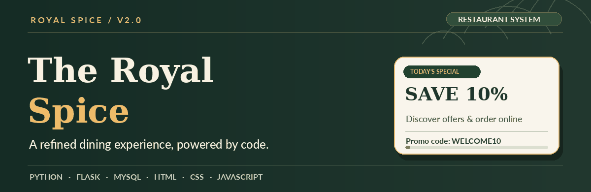
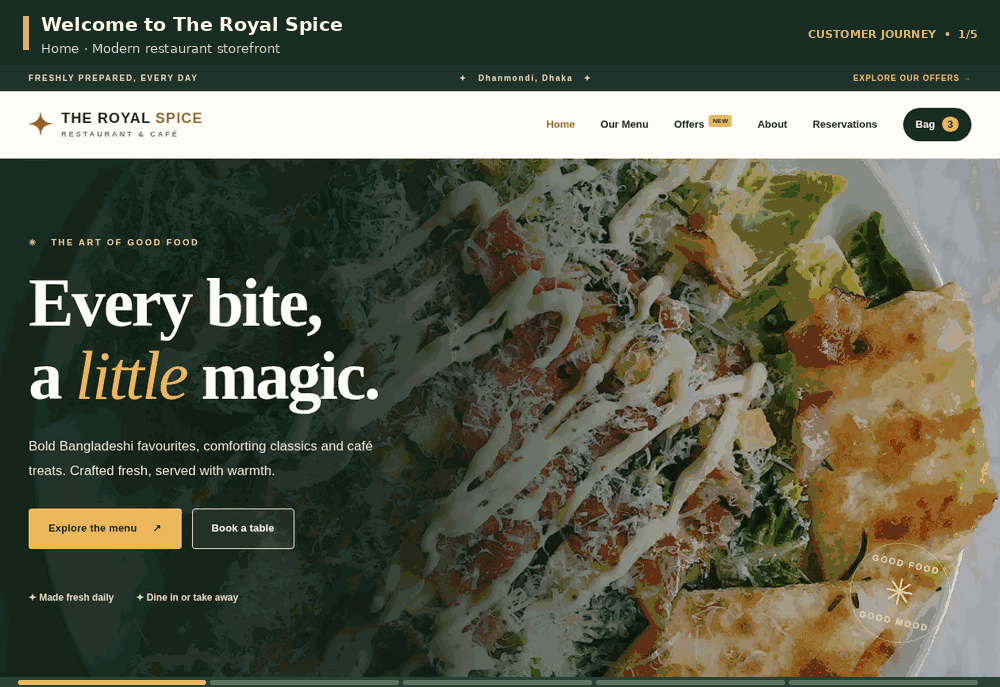
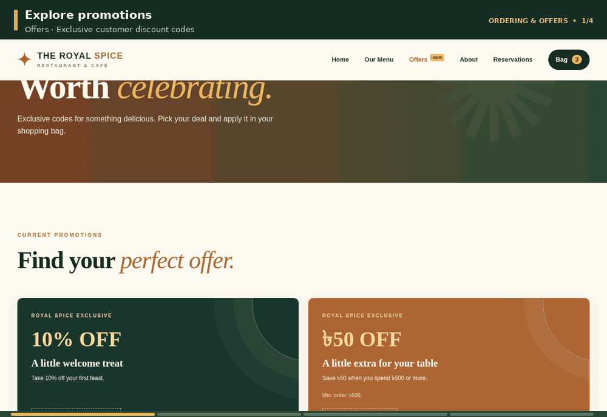
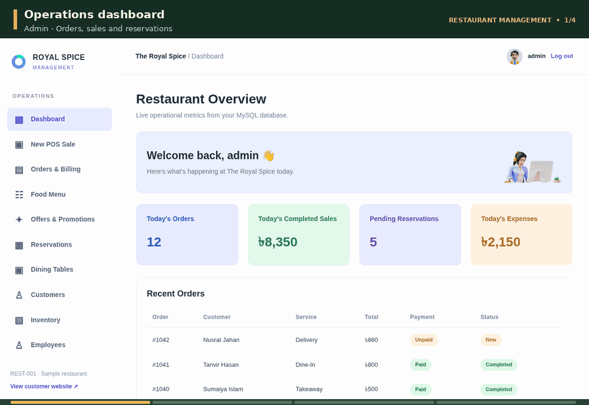

# 🍽️ The Royal Spice

**Restaurant Website & Management System**  
*A modern dining experience with a connected restaurant management dashboard.*

   

## 🍽️ About the Project

**The Royal Spice** is a dynamic restaurant platform combining a customer-facing food-ordering website with an administration and POS dashboard. Built with **Python and Flask**, it uses **MySQL** to connect menus, orders, reservations, and promotions.

## ✨ Key Features

| Customer Experience | Staff & Admin Dashboard |
| --- | --- |
| 🍛 Searchable menu with category filters | 📊 Business dashboard |
| 🛒 Shopping cart, checkout & receipts | 🧾 Order management & POS |
| 🏷️ Promotions and discount codes | 🎁 Create and manage offers |
| 📅 Reservation requests | 🍽️ Menu and table management |
| 🚚 Dine-in, takeaway & delivery orders | 👥 Staff, customers & inventory |
| 📱 Responsive interface | 📈 Expense and sales reports |

## 🎨 Design & Experience

- **Style:** Forest green, gold and ivory with food photography.
- **Layout:** Elegant hero section, food cards, offers and responsive navigation.
- **Motion:** Smooth scrolling, hover transitions and animated README showcases.
- **Interactions:** Live menu search, category filtering and mobile navigation.
- **Templates:** Customer pages adapted from **Spice Haven**; admin pages adapted from **TailwindAdmin**.

## 🛠️ Languages & Technologies

| Layer | Technologies |
| --- | --- |
| **Backend** | Python · Flask · Flask-SQLAlchemy |
| **Frontend** | HTML5 · CSS3 · JavaScript · Jinja2 |
| **Database** | MySQL / MariaDB · XAMPP · PyMySQL |
| **Authentication & Forms** | Flask-Login · Flask-WTF |
| **Interface** | Spice Haven · TailwindAdmin (adapted) |

## 📱 Application Pages

*Animated previews of the project templates using fictional sample data.*

### 🍽️ Customer Experience

`Home` · `Menu & Search` · `Reservations`

### 🏷️ Offers & Online Ordering

`Special Offers` · `Shopping Cart` · `Promo Codes` · `Checkout`

### 📊 Admin Dashboard & POS

`Overview` · `Offer Management` · `Point of Sale`

---

**The Royal Spice · Version 2.0**  
*Local development MVP with fictional restaurant data. Not yet production-ready.*
